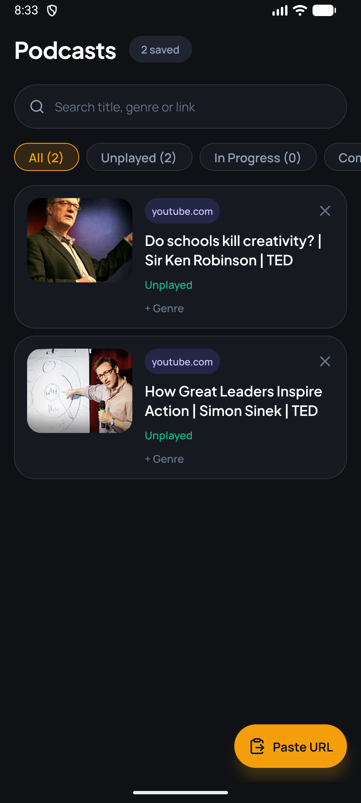

# Podcast Player

An Android audio player for podcasts and talks that live behind web links (currently YouTube). Paste a URL, the app resolves it to an audio-only stream on-device, and plays it with background and lock-screen support. It remembers where you stopped.

There is no backend: all resolving happens on the phone.

<p align="center">
  
  &nbsp;&nbsp;
  
</p>

## Features

- Paste a link (or use the clipboard paste button) to add it to your library
- Background playback with lock-screen controls
- Resume where you left off; filter by Unplayed / In Progress / Completed
- Genre playlists and a queue with repeat modes
- Playback speed and a draggable scrubber
- Optional compressor and vocal-boost audio effects (native module)

See [PRD.md](PRD.md) for the full requirements and [DESIGN.md](DESIGN.md) for the design system.

## Stack

Expo SDK 58, React Native 0.88, Expo Router, Zustand, `expo-audio`, AsyncStorage. Two local Kotlin native modules in `modules/`: `newpipe-resolver` (URL → audio stream) and `audio-effects`.

**Android only** — both native modules are Android/Kotlin.

## Getting started

The app uses custom native modules, so Expo Go will not work. You need a development build.

```bash
npm install
npm run android     # build and run on a device or emulator
npm start           # start the dev server for an installed dev build
```

## Scripts

| Command | What it does |
|---|---|
| `npm start` | Start the Expo dev server |
| `npm run android` | Build and run on Android |
| `npm run build:apk` | Release APK via Gradle (`android/`) |
| `npm run lint` | Lint `src/`, including layer-boundary rules |
| `npm test` | Unit tests on plain Node (`src/**/*.test.ts`) |
| `npx tsc --noEmit` | Typecheck |

## Project structure

Code lives under `src/` in three layers that depend downwards only (presentation → business → data); lint fails on a wrong-way import.

```
src/app/            Expo Router routes (re-export screens only)
src/presentation/   screens, components, theme
src/business/       feature logic, hooks, Zustand stores
src/data/           storage, device access, parsers, port interfaces
src/shared/utils/   pure helpers any layer may use
modules/            native Android modules (newpipe-resolver, audio-effects)
documentation/      technical-solution notes
e2e/                Cucumber + Appium scaffold
```

Details: [documentation/tehnical-solution/three layer architecture.md](documentation/tehnical-solution/three%20layer%20architecture.md). Contributor and agent conventions are in [AGENTS.md](AGENTS.md).

## TODO

- [ ] Minimal video playback: a "Watch video" button on the Player screen using `expo-video` and a muxed stream from NewPipe. Planned, not started; see [documentation/tehnical-solution/video playback.md](documentation/tehnical-solution/video%20playback.md).
- [ ] Internationalization: translate the UI into the device language (`expo-localization` + a translation library), with the business layer emitting message keys. Planned, not started; see [documentation/tehnical-solution/internationalization.md](documentation/tehnical-solution/internationalization.md).

## License

MIT — see [LICENSE](LICENSE).
